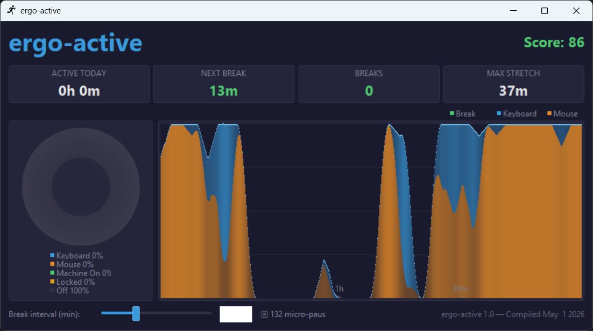

# ergo-active

[](https://github.com/ZacWalk/ergo-active/actions/workflows/build.yml)

ergo-active is a small Windows x64 break reminder. It monitors keyboard and
mouse activity, keeps a rolling activity window, runs from the system tray, and
reminds you to take regular breaks.



## Features

- **Activity monitoring** — samples `GetLastInputInfo` every ten seconds
  without hooks or drivers. A locked session counts as time away.
- **Break reminders** — configurable 20–120 minute interval, green/yellow/red
  tray urgency, rotating posture tips and the 20-20-20 eye rule. Overdue break
  warnings always win over the eye reminder.
- **Dashboard** — dark stat cards, a four-hour keyboard/mouse/break activity
  graph, a daily usage pie chart, and a DPI-aware slider and numeric editor for
  the break interval.
- **Daily history** — up to 30 days in
  `%APPDATA%\ergo-active\history.csv`; the rolling window survives restarts in
  `%APPDATA%\ergo-active\usage.dat`. Time the app was closed or the machine
  slept counts as time away.
- **System tray** — urgency icons, a live tooltip, balloon tips, a context menu
  that also opens from the keyboard, and recovery when Explorer restarts.
  Starting a second copy shows the running dashboard instead.
- **Failure reporting** — a history, usage or tray update that fails is logged,
  not silently discarded.

## Building

Requires Windows x64 and Visual Studio with the Desktop C++ workload. The
vendored [dd](https://github.com/ZacWalk/dd) runtime locates Visual Studio,
CMake and Ninja.

```powershell
.\dd.ps1 build                    # Debug and Release
.\dd.ps1 test --label ergo-active # headless tests only
.\dd.ps1 test --label headless    # the same no-visible-UI gate, with console check counts
```

The executable is `exe\ergo-active-64.exe` (Debug adds `d`). It links
[libdesktop](https://github.com/ZacWalk/libdesktop) at its pinned revision, or
a sibling `..\libdesktop` checkout when one exists.

The labelled tests cover the rolling window, history persistence and failure
reporting, the dashboard's layout, rendering, input, flushing and reminder
policy, and the embedded PerMonitorV2 manifest, without opening a window. An
unfiltered `.\dd.ps1 test` also starts the app to check that its window
appears. Do not use that unfiltered command for unattended verification: a
second instance can signal the user's running reminder to show itself.

Both labels expose passing output and the behavioural suites' real check
counts. After building, `ctest --preset debug -L headless -V --no-tests=error`
reruns without rebuilding; use `release` for Release. Neither labelled gate
launches the reminder.

### Icons

`python tools\generate_icon.py` regenerates the running-figure icon in
`src\res\ergo-active.ico`, in nine desktop sizes. Add `--check` to verify
without writing, or `--output tmp\icon-128.png --size 128` for another size.
`--variant tray-green` (also `tray-amber` and `tray-red`) with `--output` exports
the check-and-disc tray motif; the live tray keeps its urgency and recovery policy.
Only Python 3.9+'s standard library and the vendored `tools\iconlib.py` are needed.

## License

[MIT](LICENSE). The executable includes
[libdesktop](https://github.com/ZacWalk/libdesktop), which is licensed under the
Mozilla Public License 2.0: anyone distributing the executable must tell its
recipients where to get libdesktop's source code, including any changes made to
it. `tools/iconlib.py` is vendored from libdesktop under the same licence.
